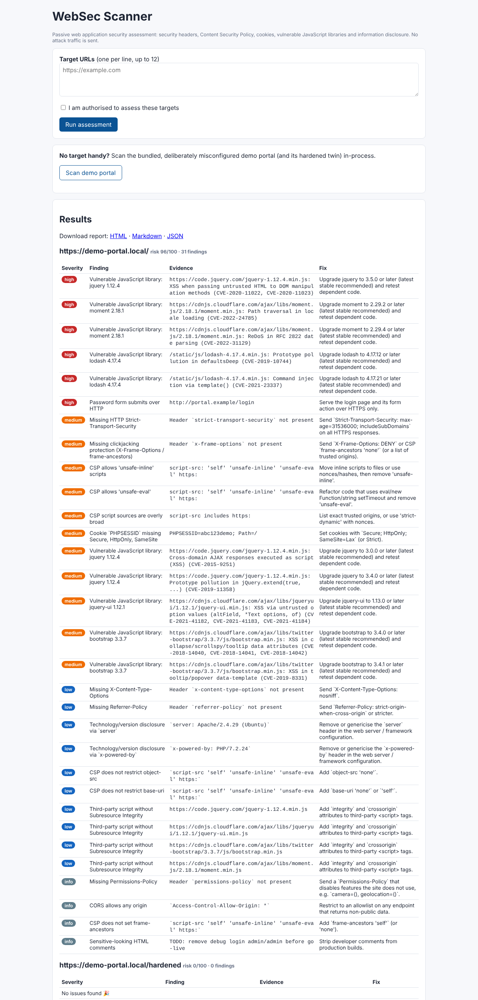

# WebSec Scanner: Passive Web Application Security Assessment

A Python toolkit and web UI that assesses web applications for common, high-impact misconfigurations and produces a vulnerability assessment report with **evidence, impact analysis and remediation** for each finding.

> **Demo recreation.** This is an original tool modelled on the assessment workflow I used as a Web Application Security intern at the Jharkhand Agency for Promotion of Information Technology (JAP-IT), where I assessed 12 government web applications and reported 45+ critical issues. No government systems, findings or report content are included; the bundled target is a fictional, deliberately misconfigured demo portal.



## What it checks

| Area | Checks |
|---|---|
| **Vulnerable JavaScript libraries** (OWASP A06) | Detects jQuery, jQuery UI, Bootstrap, AngularJS, Lodash, Moment, Handlebars, Underscore and DOMPurify from script URLs and file banners; matches versions against CVEs (e.g. jQuery < 3.5.0 → CVE-2020-11022/11023) |
| **Content Security Policy** | Missing / report-only CSP, `'unsafe-inline'` without nonces, `'unsafe-eval'`, wildcard and `https:` sources, missing `object-src`, `base-uri`, `frame-ancestors` |
| **HTTP security headers** | HSTS (and short max-age), X-Frame-Options, X-Content-Type-Options, Referrer-Policy, Permissions-Policy |
| **Cookies** | Missing `Secure`, `HttpOnly`, `SameSite`; session-like names raised to medium |
| **Transport** | Plain HTTP, mixed-content scripts, password forms posting over HTTP |
| **Information disclosure** | `Server` / `X-Powered-By` version strings, sensitive HTML comments |
| **CORS & supply chain** | Wildcard CORS (with credentials = high), third-party scripts without SRI |

Every check is **passive**: one normal GET for the page (plus same-origin script files for banner detection). No payloads, fuzzing or brute force. The web UI requires an "I am authorised" confirmation and blocks private/loopback targets (SSRF guard) unless `ALLOW_PRIVATE_TARGETS=1`.

## Quick start

```bash
python -m venv .venv && source .venv/bin/activate
pip install -r requirements.txt
python wsgi.py                 # web UI at http://localhost:5002, click "Scan demo portal"
```

### CLI

```bash
python -m scanner https://your-app.example --out reports            # HTML + Markdown + JSON
python -m scanner --batch targets.txt --format html                 # one consolidated report for many apps
python -m scanner https://staging.example --fail-on high            # exit 1 for CI pipelines
python -m demo_target & python -m scanner http://127.0.0.1:8081 --allow-private   # local lab
```

A sample report generated from the demo portal is in [`sample_reports/`](sample_reports/demo_portal_report.md).

## Tests

```bash
pytest -q
```

## Deploy

- **Render**: *New > Blueprint* with this repo (`render.yaml`).
- **Docker**: `docker build -t websec . && docker run -p 8000:8000 websec`

## Layout

```
scanner/core.py     checks + SSRF guard + scan_url()
scanner/jslibs.py   library/version fingerprinting
scanner/vulndb.py   curated vulnerable-version database
scanner/report.py   Markdown / HTML / JSON report rendering
web/                Flask UI
demo_target/        deliberately misconfigured portal + hardened twin
```

## Disclaimer

Only scan applications you own or have written permission to assess.

## Author and contributors

- **Sandeep Kashyap** ([@sktut](https://github.com/sktut)), author and maintainer
